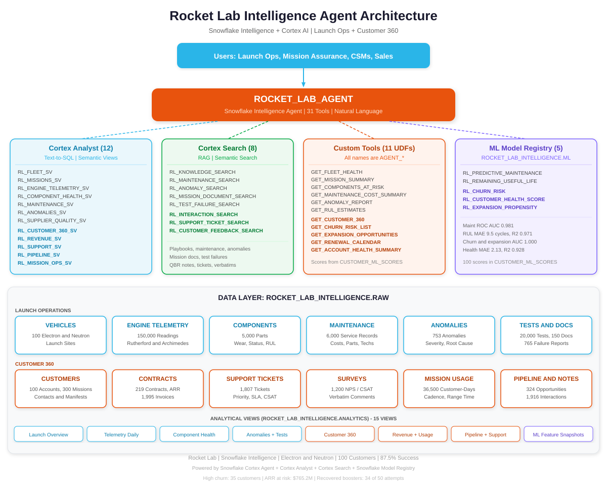
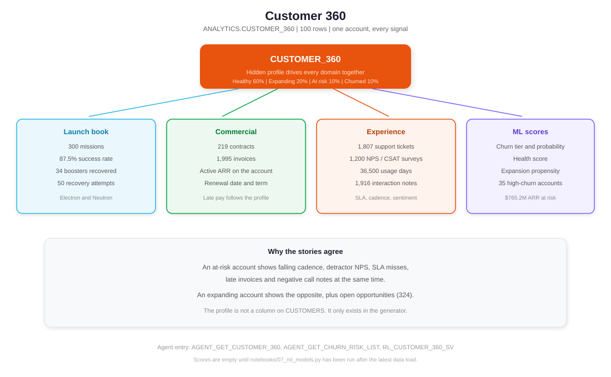
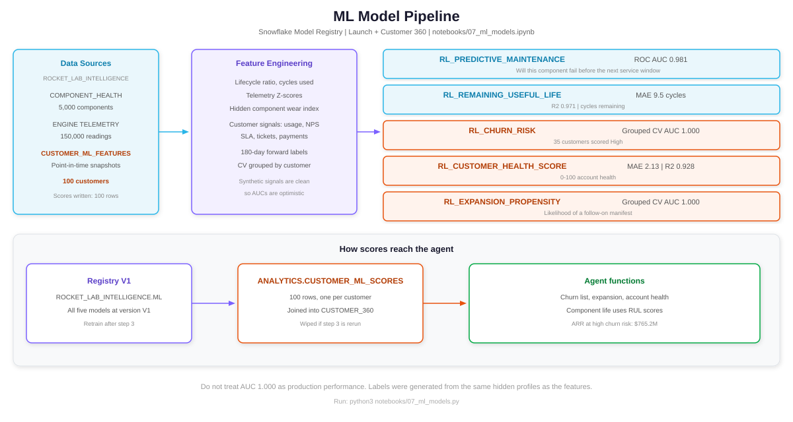
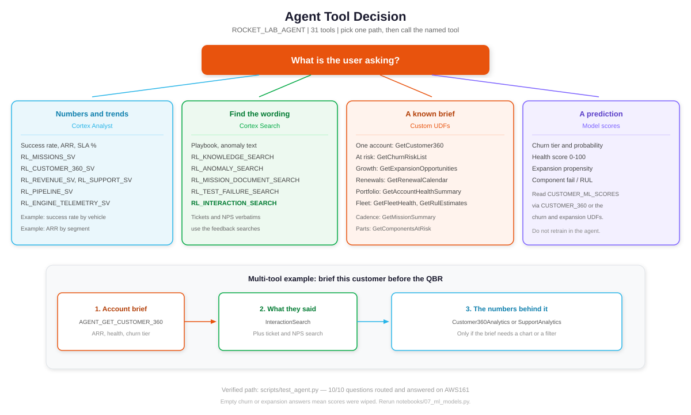
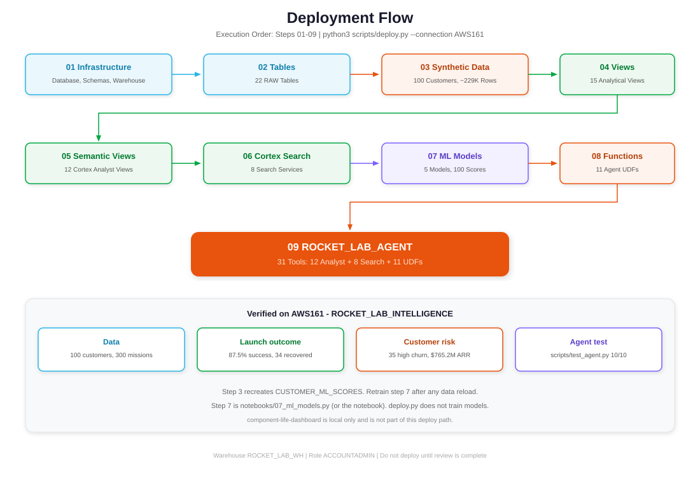

<br>


# Rocket Lab — Snowflake Intelligence Agent

A Snowflake Intelligence agent for Rocket Lab launch operations and Customer 360. It answers natural language questions over Electron and Neutron vehicles, missions, engine telemetry, components, maintenance, anomalies, suppliers, tests and mission documents, and over contracts, invoices, support, NPS, mission-operations usage, pipeline and account interactions.

The implementation is complete on account `AWS161`. Nothing further is deployed from this review pass.

---

## Architecture



---

## Overview

The agent (`SNOWFLAKE_INTELLIGENCE.AGENTS.ROCKET_LAB_AGENT`, display name Rocket Lab Assistant) has 31 tools:

- **Cortex Analyst**: text-to-SQL over 12 semantic views (7 launch, 5 Customer 360)
- **Cortex Search**: 8 services over mission documents, test failures, knowledge articles, maintenance text, anomalies, interaction notes, support tickets and survey verbatims
- **Custom functions**: 11 agent functions (6 launch, 5 Customer 360)
- **ML models**: 5 version-V1 models in `ROCKET_LAB_INTELLIGENCE.ML`

Verified on the loaded data: 100 customers, 100 vehicles, 300 missions, 5,000 components, 150,000 engine readings, 6,000 maintenance records, 753 anomalies, 20,000 tests, 765 failure reports, 150 mission documents, 219 contracts, 1,995 invoices, 1,807 tickets, 1,200 surveys, 36,500 usage days, 324 opportunities and 1,916 interactions.

Launch success rate is 87.5%. Electron recovery was attempted on 50 missions and the booster was recovered on 34. Thirty-five customers are scored High churn, with $765.2M of active ARR on those accounts. All 15 analytical views are in `ANALYTICS`. `CUSTOMER_ML_SCORES` has 100 rows.

---

## Customer 360



`ROCKET_LAB_INTELLIGENCE.ANALYTICS.CUSTOMER_360` is one row per customer. It joins firmographics, active ARR and renewals, invoices, tickets and SLA, NPS, mission-operations usage, pipeline, interaction sentiment and the ML scores.

The generator assigns each of the 100 customers a hidden profile (about 60% healthy, 20% expanding, 10% at risk, 10% churned). That profile is not a column. It drives correlated signals, so an at-risk account shows falling cadence, detractor NPS, SLA misses, late invoices and negative call notes together.

---

## ML models



| Model | Task | Latest metric |
|---|---|---|
| `RL_PREDICTIVE_MAINTENANCE` | Component fails before next service | ROC AUC 0.981 |
| `RL_REMAINING_USEFUL_LIFE` | Cycles remaining | MAE 9.5 cycles, R² 0.971 |
| `RL_CHURN_RISK` | Account will churn | Grouped CV AUC 1.000 |
| `RL_CUSTOMER_HEALTH_SCORE` | Health score | CV MAE 2.13, R² 0.928 |
| `RL_EXPANSION_PROPENSITY` | Follow-on business | Grouped CV AUC 1.000 |

The customer AUCs are optimistic. Labels come from the same hidden profiles that generate the features. Say so when quoting a score.

Step 3 recreates `ANALYTICS.CUSTOMER_ML_SCORES`. After any data reload, rerun `python3 notebooks/07_ml_models.py` before asking churn or expansion questions. Empty score answers are the symptom.

---

## How the agent chooses a tool



Numbers and trends go to a semantic view (`Customer360Analytics`, `MissionAnalytics`, and the other Analyst tools). Wording — a playbook, a failure report, a QBR note, a ticket, an NPS comment — goes to a search service. A known brief goes to a function: `GetCustomer360`, `GetChurnRiskList`, `GetExpansionOpportunities`, `GetRenewalCalendar`, `GetAccountHealthSummary`, `GetFleetHealth`, `GetMissionSummary`, `GetComponentsAtRisk`, `GetRulEstimates`, `GetMaintenanceCosts`, `GetAnomalyReport`.

---

## Quick start

This repository is already deployed on `AWS161`. To rebuild after review:

```bash
python3 scripts/deploy.py --connection AWS161          # steps 1-6, 8, 9
python3 notebooks/07_ml_models.py                       # step 7
python3 scripts/test_agent.py --connection AWS161       # 10 questions
```

`deploy.py` does not train models. Step 7 needs `snowflake-ml-python`, `xgboost` and `scikit-learn`, or run `notebooks/07_ml_models.ipynb` in Snowflake.

SQL files, in order:

```text
sql/setup/01_database_and_schema.sql      # database, RAW, ANALYTICS, ROCKET_LAB_WH
sql/setup/02_create_tables.sql            # 22 RAW tables
sql/data/03_generate_synthetic_data.sql   # one session; uses temp tables
sql/views/04_create_views.sql             # 15 views + CUSTOMER_ML_SCORES
sql/views/05_create_semantic_views.sql    # 12 semantic views
sql/search/06_create_cortex_search.sql    # 8 Cortex Search services
notebooks/07_ml_models.ipynb              # 5 models, writes 100 scores
sql/models/08_ml_model_functions.sql      # 11 agent functions
sql/agent/09_create_agent.sql             # ROCKET_LAB_AGENT
```

Warehouse: `ROCKET_LAB_WH`. Open **AI & ML > Snowflake Intelligence** and select **Rocket Lab Assistant**.

The component-life Streamlit app in `component-life-dashboard/` is local only. It is not deployed.

---

## Deployment flow



---

## Project structure

```text
sql/setup/          Steps 1-2
sql/data/           Step 3 synthetic data
sql/views/          Steps 4-5 views and semantic views
sql/search/         Step 6 Cortex Search
notebooks/          Step 7 ML
sql/models/         Step 8 agent functions
sql/agent/          Step 9 agent
scripts/            deploy.py, test_agent.py, check_svg.py, build_notebook.py
docs/               Setup, questions, artifacts, this review's diagrams
component-life-dashboard/   Local Streamlit app, not deployed
```

## Documentation

- [Setup](docs/AGENT_SETUP.md)
- [Questions](docs/questions.md)
- [Artifacts](docs/ARTIFACTS_GUIDE.md)
- [What is deployed](docs/DEPLOYMENT_SUMMARY.md)
- [Build log](BUILD_LOG.md)
- [Agent behavior](agent.md)
