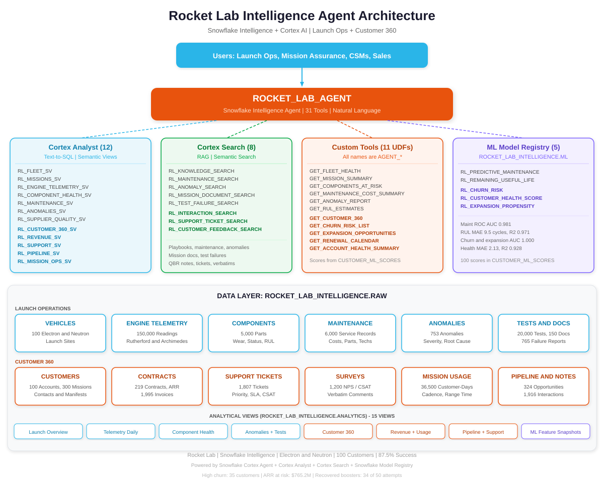
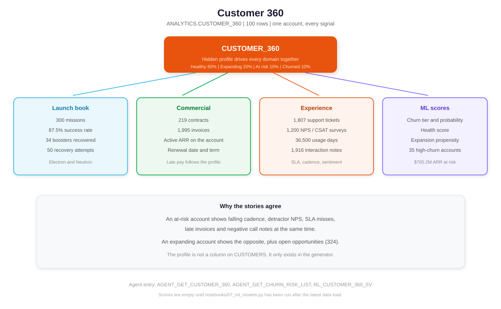
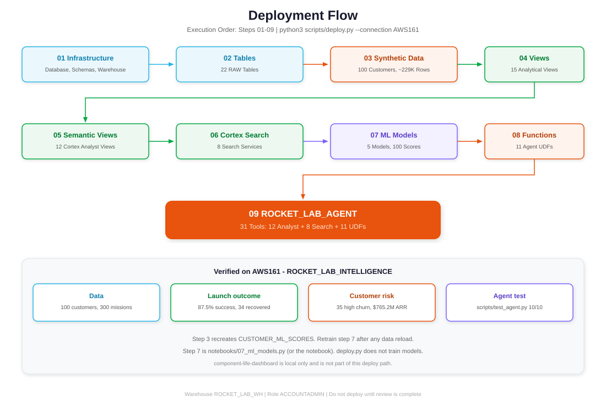
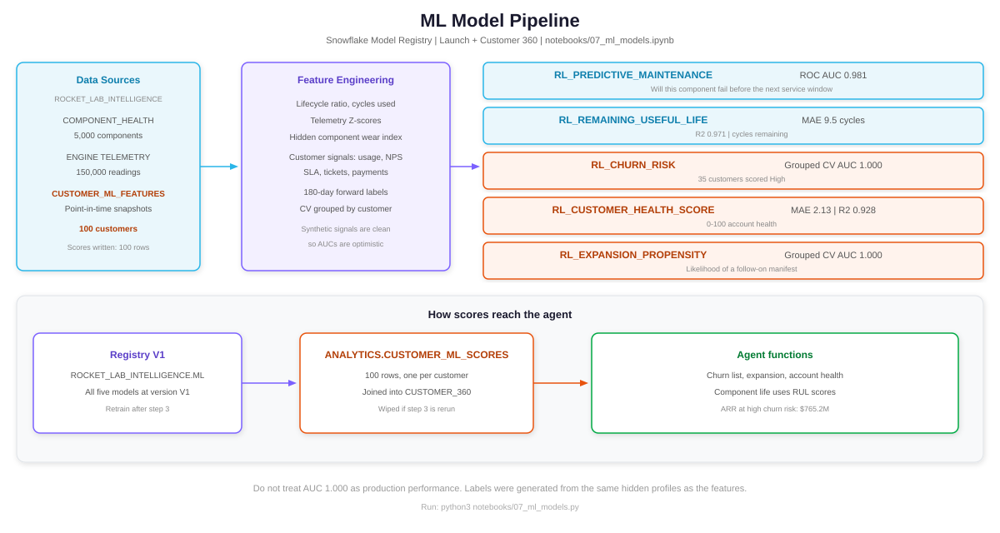
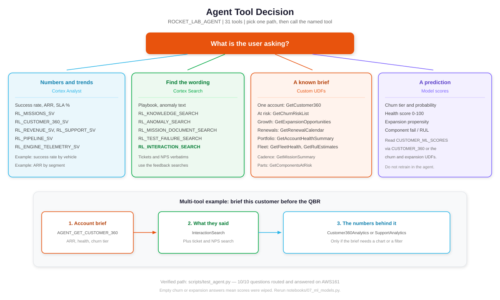

# Rocket Lab Intelligence Agent — Setup

Deploy `ROCKET_LAB_AGENT` on Snowflake. The copy in this repository is already loaded on account `AWS161` (`ROCKET_LAB_INTELLIGENCE`, warehouse `ROCKET_LAB_WH`). Review first. Deploy only when you choose to.

## Prerequisites

- A role that can create databases, warehouses, semantic views, Cortex Search services, functions and agents. The verified deploy used `ACCOUNTADMIN`.
- Cortex Analyst, Cortex Search, Cortex Agents and the Model Registry enabled.
- Python 3.11 with `snowflake-connector-python` for `scripts/deploy.py`.
- For step 7, run locally (`snowflake-ml-python`, `xgboost`, `scikit-learn`) or run the notebook in Snowflake.

## Architecture



31 tools:

- Cortex Analyst: 12 semantic views
- Cortex Search: 8 services
- Custom functions: 11
- ML models: 5, version V1, in `ROCKET_LAB_INTELLIGENCE.ML`



## Deploy



```bash
python3 scripts/deploy.py --connection AWS161
python3 notebooks/07_ml_models.py
python3 scripts/test_agent.py --connection AWS161
```

`deploy.py` runs each SQL file in one session. Step 3 needs that, because it uses temporary tables. Pass `--steps 3 4` to rerun a subset. Step 7 is not inside `deploy.py`.

### Step 1 — Database and warehouse

`sql/setup/01_database_and_schema.sql` creates `ROCKET_LAB_INTELLIGENCE`, schemas `RAW` and `ANALYTICS`, and warehouse `ROCKET_LAB_WH`. Step 7 creates schema `ML`.

```sql
SHOW SCHEMAS IN DATABASE ROCKET_LAB_INTELLIGENCE;
SHOW WAREHOUSES LIKE 'ROCKET_LAB_WH';
```

### Step 2 — Tables

`sql/setup/02_create_tables.sql` creates 22 tables in `RAW`.

Launch: vehicles, missions, components, engine telemetry, maintenance, anomalies, suppliers, tests, mission documents, failure reports, knowledge and related reference tables.

Customer 360: customers, contacts, contracts, invoices, support tickets, surveys, mission-operations usage, opportunities, interactions.

```sql
SHOW TABLES IN SCHEMA ROCKET_LAB_INTELLIGENCE.RAW;
```

### Step 3 — Synthetic data

`sql/data/03_generate_synthetic_data.sql` must run as one script. It assigns a hidden customer profile and a hidden component wear index, then writes correlated rows.

Verified counts: customers 100, vehicles 100, missions 300, components 5,000, telemetry 150,000, maintenance 6,000, anomalies 753, contracts 219, invoices 1,995, tickets 1,807, surveys 1,200, usage 36,500, opportunities 324, interactions 1,916, mission documents 150, failure reports 765, tests 20,000.

Launch success rate 87.5%. Recovery attempted 50. Boosters recovered 34.

This step recreates `ANALYTICS.CUSTOMER_ML_SCORES`. Scores are empty until step 7 runs again.

### Step 4 — Analytical views

`sql/views/04_create_views.sql` creates 15 views, including `CUSTOMER_360` (100 rows) and `CUSTOMER_ML_FEATURES`, and the empty `CUSTOMER_ML_SCORES` table that step 7 fills.

### Step 5 — Semantic views

`sql/views/05_create_semantic_views.sql` creates:

`RL_FLEET_SV`, `RL_MISSIONS_SV`, `RL_ENGINE_TELEMETRY_SV`, `RL_COMPONENT_HEALTH_SV`, `RL_MAINTENANCE_SV`, `RL_ANOMALIES_SV`, `RL_SUPPLIER_QUALITY_SV`, `RL_CUSTOMER_360_SV`, `RL_REVENUE_SV`, `RL_SUPPORT_SV`, `RL_PIPELINE_SV`, `RL_MISSION_OPS_SV`.

### Step 6 — Cortex Search

`sql/search/06_create_cortex_search.sql` creates:

`RL_MISSION_DOCUMENT_SEARCH`, `RL_TEST_FAILURE_SEARCH`, `RL_KNOWLEDGE_SEARCH`, `RL_MAINTENANCE_SEARCH`, `RL_ANOMALY_SEARCH`, `RL_INTERACTION_SEARCH`, `RL_SUPPORT_TICKET_SEARCH`, `RL_CUSTOMER_FEEDBACK_SEARCH`.

Rebuild search after recreating the underlying tables.

### Step 7 — Models

`notebooks/07_ml_models.py` (and the generated `notebooks/07_ml_models.ipynb`) trains and registers:

| Model | Metric |
|---|---|
| `RL_PREDICTIVE_MAINTENANCE` | ROC AUC 0.981 |
| `RL_REMAINING_USEFUL_LIFE` | MAE 9.5 cycles, R² 0.971 |
| `RL_CHURN_RISK` | Grouped CV AUC 1.000 |
| `RL_CUSTOMER_HEALTH_SCORE` | MAE 2.13, R² 0.928 |
| `RL_EXPANSION_PROPENSITY` | Grouped CV AUC 1.000 |

It writes 100 rows to `ANALYTICS.CUSTOMER_ML_SCORES`. Customer AUCs are optimistic because the synthetic labels and features share a hidden profile.



### Step 8 — Agent functions

`sql/models/08_ml_model_functions.sql` creates 11 functions:

`AGENT_GET_FLEET_HEALTH`, `AGENT_GET_MISSION_SUMMARY`, `AGENT_GET_COMPONENTS_AT_RISK`, `AGENT_GET_MAINTENANCE_COST_SUMMARY`, `AGENT_GET_ANOMALY_REPORT`, `AGENT_GET_RUL_ESTIMATES`, `AGENT_GET_CUSTOMER_360`, `AGENT_GET_CHURN_RISK_LIST`, `AGENT_GET_EXPANSION_OPPORTUNITIES`, `AGENT_GET_RENEWAL_CALENDAR`, `AGENT_GET_ACCOUNT_HEALTH_SUMMARY`.

### Step 9 — Agent

`sql/agent/09_create_agent.sql` creates `SNOWFLAKE_INTELLIGENCE.AGENTS.ROCKET_LAB_AGENT` with 31 tools. Analyst and search tools use the short names in the agent spec (`FleetAnalytics`, `MissionDocumentSearch`, `GetCustomer360`, and so on). The underlying objects keep the `RL_*` and `AGENT_GET_*` names.



```sql
DESCRIBE AGENT SNOWFLAKE_INTELLIGENCE.AGENTS.ROCKET_LAB_AGENT;
```

```bash
python3 scripts/test_agent.py --connection AWS161
```

The harness uses `SNOWFLAKE.CORTEX.DATA_AGENT_RUN`. Last run: 10/10. If churn or expansion answers are empty, step 3 wiped the scores. Rerun step 7.

## After deploy

In Snowsight open **AI & ML > Snowflake Intelligence** and select **Rocket Lab Assistant**.

`component-life-dashboard/` is a local Streamlit app. Its query was checked against live data (3,000 components in the dashboard query, 395 urgent, median remaining life 10 cycles). It has not been deployed.
